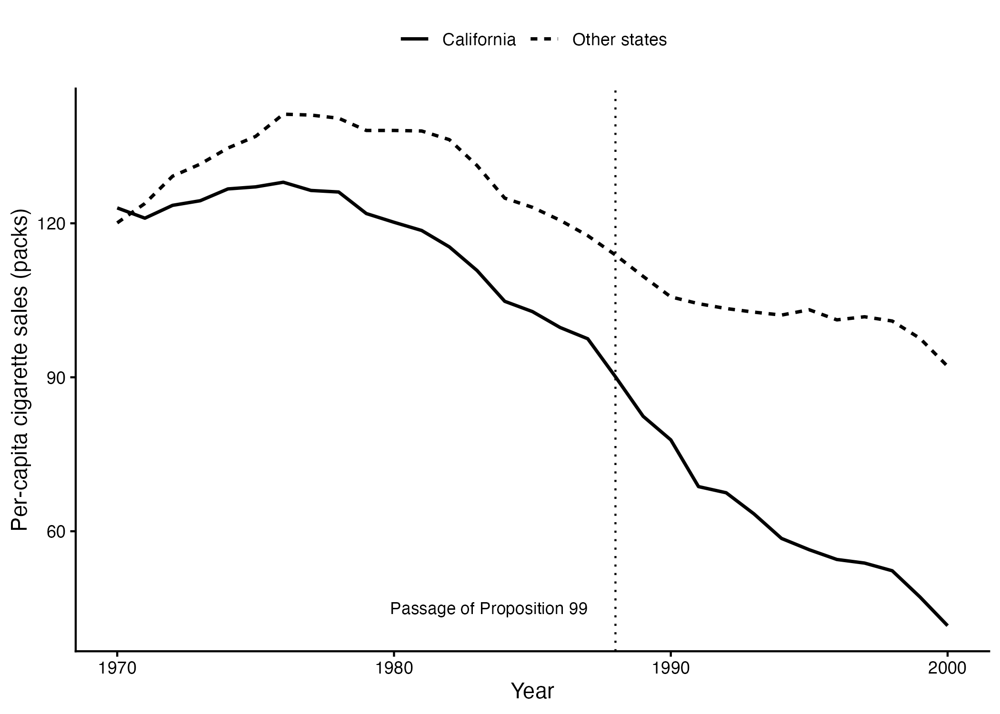
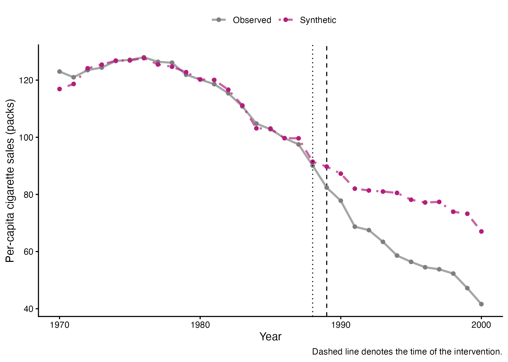
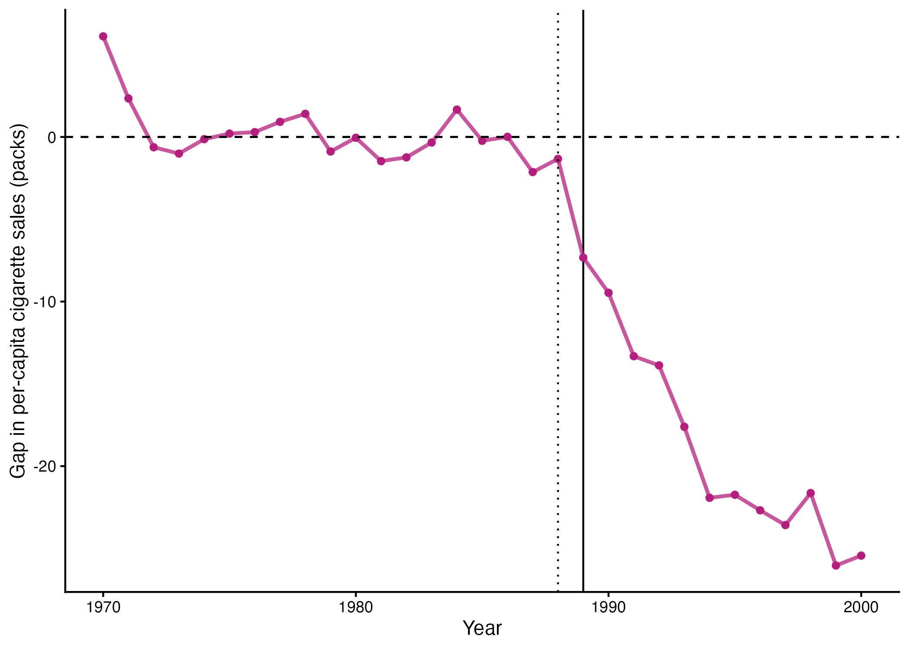
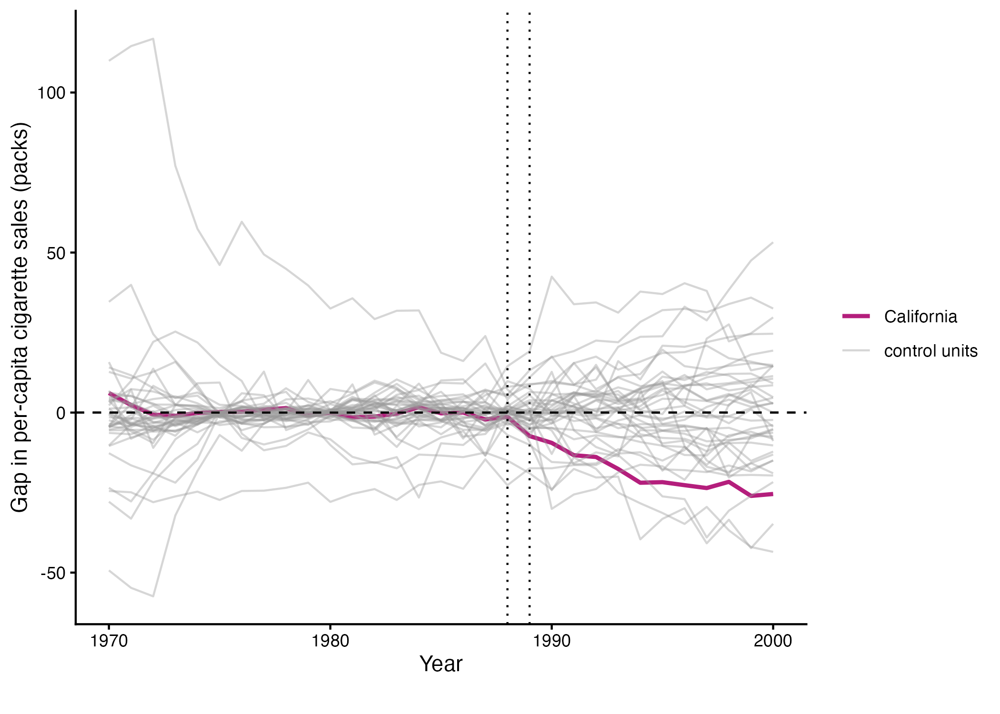

This repository replicates the main empirical results from:

> Abadie, Alberto, Alexis Diamond, and Jens Hainmueller. 2010.  
> **"Synthetic Control Methods for Comparative Case Studies: Estimating the Effect of California's Tobacco Control Program."**  
> *Journal of the American Statistical Association* 105(490): 493–505.  
> https://doi.org/10.1198/jasa.2009.ap08746

## Overview

This project replicates the California Proposition 99 application in Abadie, Diamond, and Hainmueller (2010). The paper uses the synthetic control method to estimate the effect of California's tobacco control program on per-capita cigarette sales.

California voters passed Proposition 99 in November 1988, and the program took effect in January 1989. The policy increased the state cigarette excise tax by 25 cents per pack and directed tax revenue toward health programs, anti-smoking education, and other tobacco-control activities.

The central empirical question is:

**How would cigarette consumption in California have evolved after 1988 if Proposition 99 had not been implemented?**

The synthetic control method addresses this question by constructing a weighted combination of untreated states that resembles California before the intervention. This "synthetic California" provides an estimate of the counterfactual trajectory of cigarette sales in the absence of Proposition 99.

This replication focuses on four results:

1. Cigarette sales in California compared with other states.
2. Cigarette sales in California compared with synthetic California.
3. The estimated gap between California and synthetic California.
4. In-space placebo tests comparing California's estimated effect with placebo effects for untreated states.


## Data

The replication uses the `smoking` dataset distributed with the R package [`tidysynth`](https://CRAN.R-project.org/package=tidysynth).

The analysis covers the period **1970–2000**. California is the treated unit, and treatment begins in **1989**, giving a pretreatment period of 1970–1988 and a post-treatment period of 1989–2000.

The main outcome is:

- `cigsale`: annual per-capita cigarette sales, measured in packs.

The predictors used to construct synthetic California are:

- `lnincome`: log per-capita income;
- `age15to24`: percentage of the population aged 15–24;
- `retprice`: average retail cigarette price;
- `beer`: per-capita beer consumption; and
- lagged per-capita cigarette sales in 1975, 1980, and 1988.


## Method

The synthetic control is estimated using the `tidysynth` package in R.

California is specified as the treated unit:

```r
synthetic_control(
  outcome = cigsale,
  unit = state,
  time = year,
  i_unit = "California",
  i_time = 1989,
  generate_placebos = TRUE
)
```

The predictors are constructed as follows:

```r
generate_predictor(
  time_window = 1980:1988,
  lnincome = mean(lnincome, na.rm = TRUE),
  age15to24 = mean(age15to24, na.rm = TRUE),
  retprice = mean(retprice, na.rm = TRUE)
) %>%

generate_predictor(
  time_window = 1984:1988,
  beer = mean(beer, na.rm = TRUE)
) %>%

generate_predictor(
  time_window = 1975,
  cigsale_1975 = cigsale
) %>%

generate_predictor(
  time_window = 1980,
  cigsale_1980 = cigsale
) %>%

generate_predictor(
  time_window = 1988,
  cigsale_1988 = cigsale
)
```

The synthetic-control weights are optimized over the full **1970–1988 pretreatment period**.


# Results

## Figure 1: California vs. Other States



**Figure 1. Per-capita cigarette sales in California compared with other states, 1970–2000.**

Cigarette consumption in California was already following a somewhat different trajectory from other states before Proposition 99. Consumption in California peaked in the 1970s and subsequently declined more rapidly.

After the passage of Proposition 99 in 1988, the difference becomes substantially larger. California experiences a particularly pronounced decline in per-capita cigarette sales during the post-intervention period.

This comparison also illustrates why simply comparing California with an average of other states may not provide an adequate counterfactual. The two series do not follow the same trajectory during the pretreatment period.


## Figure 2: California vs. Synthetic California



**Figure 2. Per-capita cigarette sales in California and synthetic California, 1970–2000.**

Synthetic California closely tracks actual California during most of the pretreatment period. This close pretreatment fit is important because it suggests that the synthetic control provides a more credible counterfactual for California than a simple average of other states.

After Proposition 99, the two series diverge sharply.

Actual cigarette sales in California fall much more rapidly than cigarette sales in synthetic California. By the late 1990s, the difference between observed and synthetic cigarette consumption is substantial.


## Figure 3: Estimated Effect of Proposition 99



**Figure 3. Gap in per-capita cigarette sales between California and synthetic California.**

The estimated treatment effect in each year is calculated as

$$
\widehat{\tau}_t = Y_{\mathrm{California},t} - Y_{\mathrm{Synthetic\ California},t}
$$

Before Proposition 99, the gap fluctuates around zero, consistent with the relatively close pretreatment fit observed in Figure 2.

After the intervention, the gap becomes increasingly negative. This indicates that actual cigarette sales in California were substantially below the level predicted by synthetic California.

By the end of the sample period, the estimated gap is approximately **25–26 packs per capita**.

The original study reports that over the entire 1989–2000 period, cigarette consumption was reduced by an average of almost **20 packs per capita**, corresponding to a decline of approximately **25 percent**.


## Figure 4: In-Space Placebo Tests


